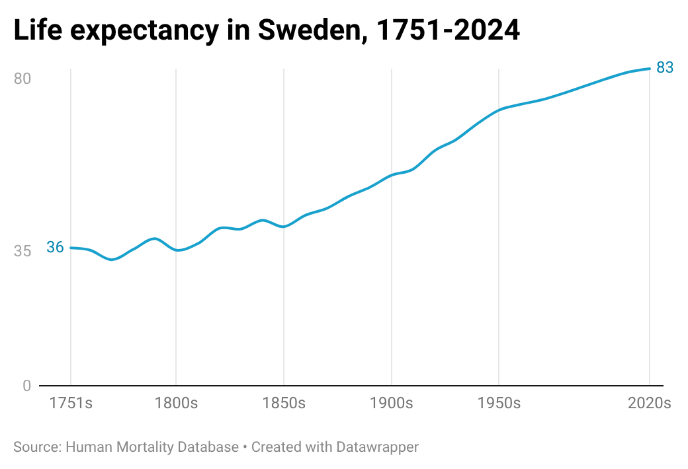
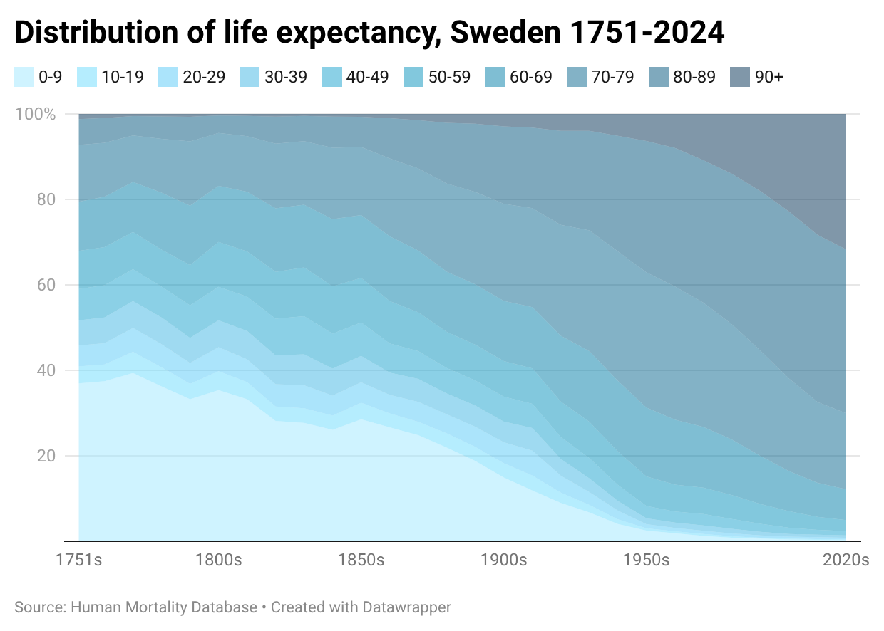
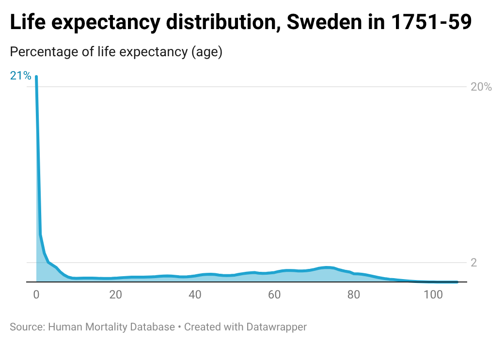
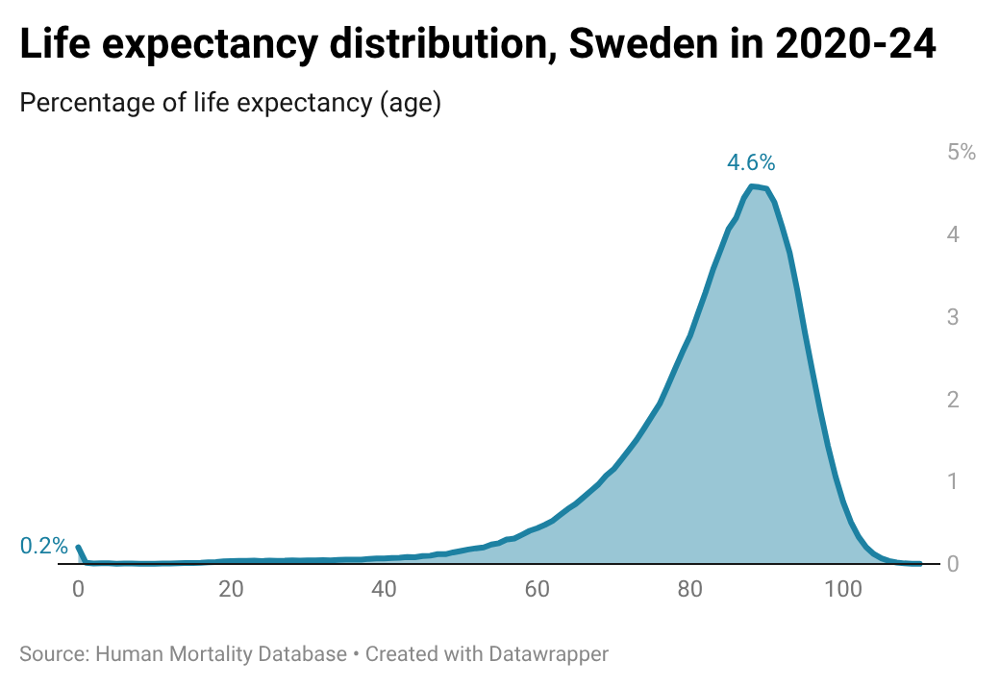
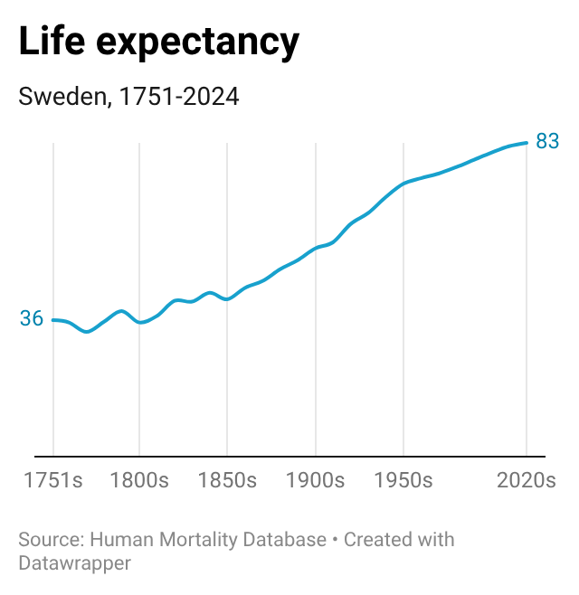
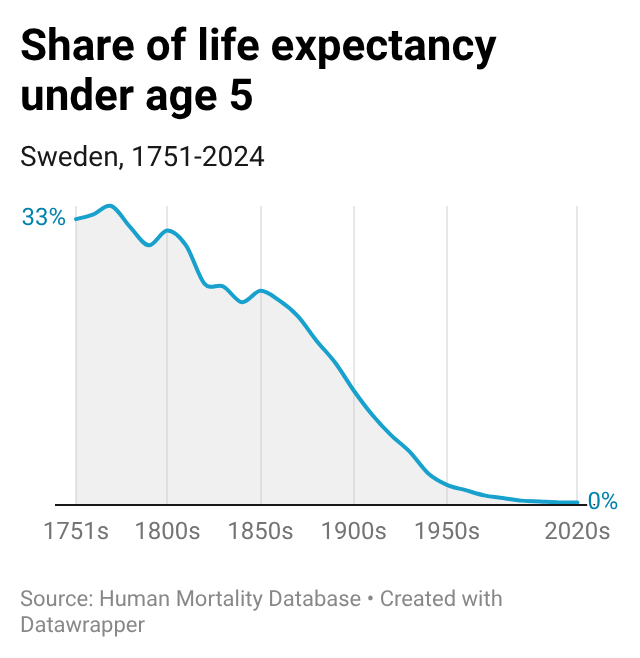
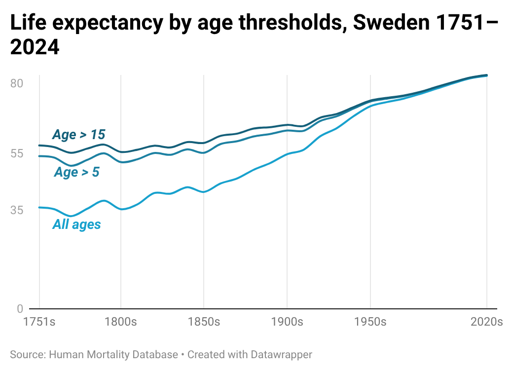
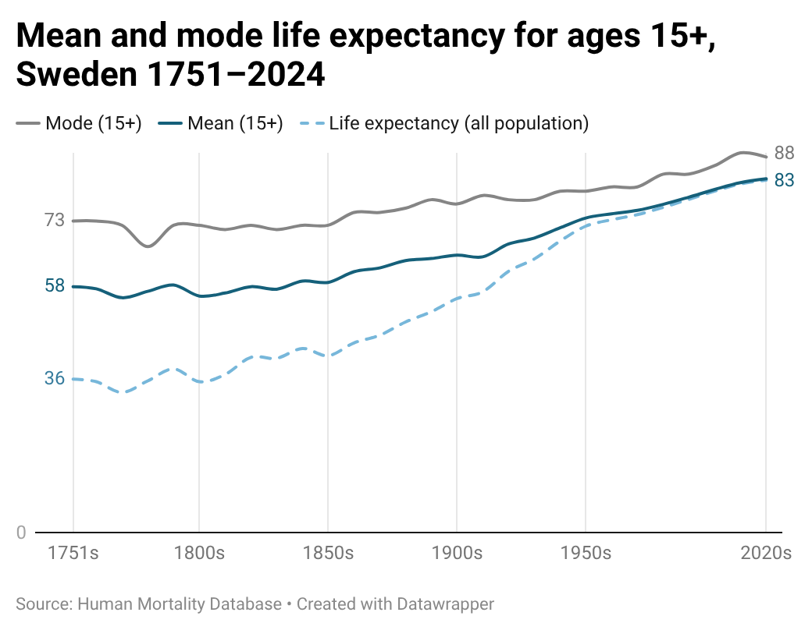

# What happened when life expectancy grew +230%, from 36 to 83?

Life expectancy in Sweden grew from 36 to 83 between 1751 and 2024, according to Sweden's long-running historical population records.

However, people's typical lifespan did not actually grow by more than two times. Most of this change reflects the reduction in child mortality, alongside a modest increase in adult life expectancy.

Life expectancy is the average number of years a group of people is expected to live, based on mortality rates in that year.

It is an average metric that combines two different lifespan distributions: children with high mortality, and adults.

In the 1750s, a large proportion of the population had very short life expectancies. Newborns faced the highest risk of mortality. Under the conditions of that period, an estimated 33% of the population would not reach age 5.

For the 67% who survived beyond age 5, total life expectancy averaged 55 years. Among adults, the most common lifespan was in the 70s. (_This average of 55 is lower than 70 because adult lifespans had a right-skewed distribution._)

By the 2020s, the early-mortality group had decreased to under 0.3%. The adult-life distribution now shaped the overall pattern.

## How did life expectancy change from 36 to 83?

The increase from 36 to 83 largely follows the trend of declining early-life mortality.

<table>
  <tr>
    <td width="50%">
      
    </td>
    <td width="50%">
      
    </td>
  </tr>
</table>

Excluding child mortality, the increase of life expectancy is less pronounced. By looking at the population over age 5, life expectancy grew from 55 to 83 instead of 36 to 83 (and from 58 to 83 for those over age 15).

Shifting from the mean to mode life expectancy further narrows this observed increase. While the mean life expectancy for those aged 15+ rose by 25 years (from 58 to 83), the mode increased by only 15 years (from 73 to 88).

The remaining rise from around 73 to 83 better reflects the growth in typical adult lifespan.